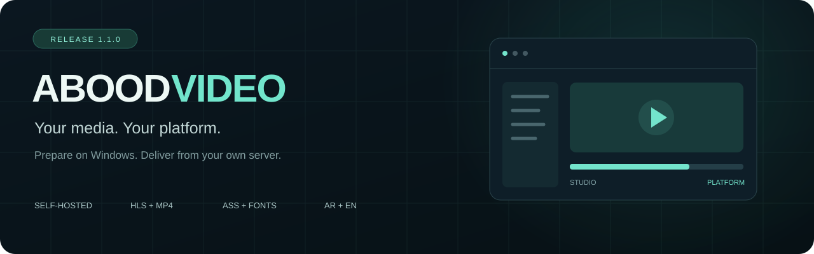
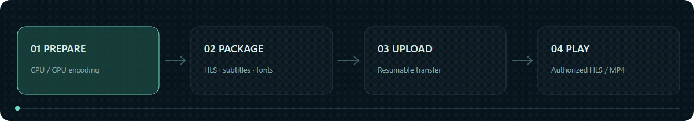
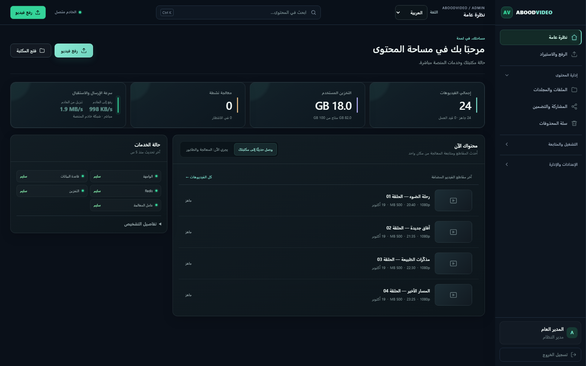
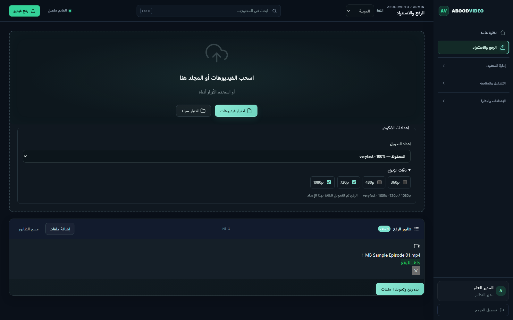
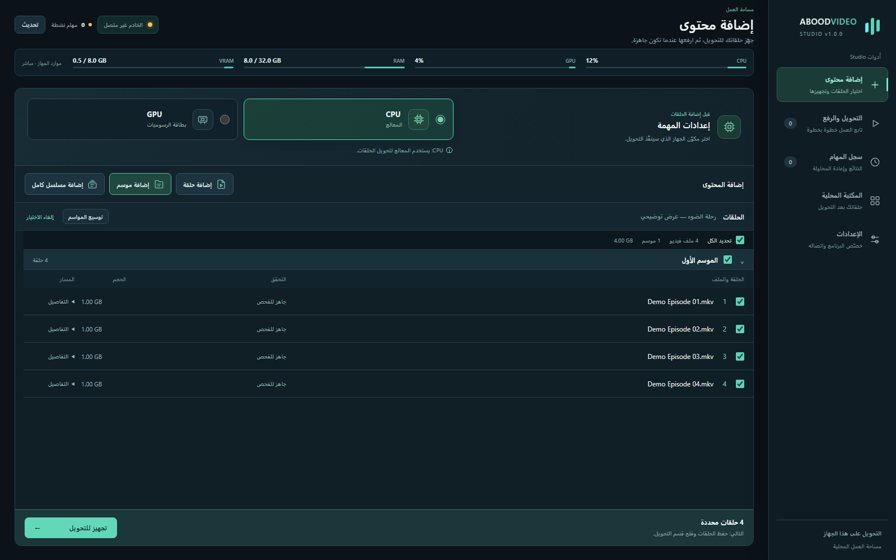
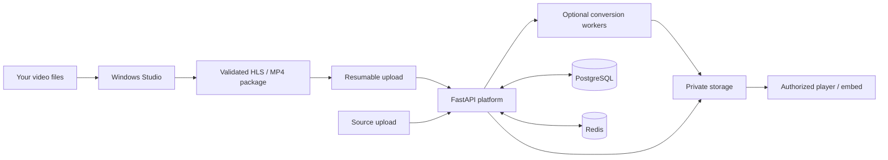

# ABOODVIDEO

[English](README.md) · **العربية**

<p align="center"></p>

<p align="center">
  <a href="https://github.com/abooodHub/ABOODVIDEO/releases"></a>
  <a href="https://github.com/abooodHub/ABOODVIDEO/actions/workflows/checks.yml"></a>
  <a href="LICENSE"></a>
  
</p>

<p align="center"><strong>ترجمة احترافية بدون حرقها داخل الفيديو.</strong><br>ستايل ASS/SSA ومواضع النص والخطوط المرفقة، مع إمكانية تبديل الترجمة أو إخفائها من المشغل.</p>

<p align="center"><a href="#واجهة-المنصة--screenshots">الصور / Screenshots</a> · <a href="#البداية-السريعة--quick-start">التثبيت / Install</a> · <a href="docs/INSTALLATION.md">دليل التشغيل / Operations</a> · <a href="https://github.com/abooodHub/ABOODVIDEO/releases">الإصدارات / Releases</a></p>

## الميزة الأهم: عرض الترجمة بدون حرق — Soft Subtitles

**تظهر الترجمة فوق الفيديو داخل المشغل، وتبقى منفصلة عن صورة الفيديو نفسها.** يدعم المشغل ستايل ASS/SSA ومواضع النص والخطوط المرفقة، إضافة إلى WebVTT، ويمكن للمشاهد تبديل مسار الترجمة أو إخفاؤها.

- **صورة الفيديو تبقى كما هي:** يعرض المشغل الترجمة دون دمجها في إطارات الفيديو.
- **الحفاظ على شكل الترجمة:** الستايل ومواضع النص والخطوط المرفقة ضمن حزمة ASS/SSA.
- **تحكم أثناء المشاهدة:** تبديل مسار الترجمة أو تشغيلها وإخفاؤها.
- **من Studio إلى المنصة:** تجهيز ملفات الترجمة والخطوط في برنامج Windows ورفعها مع الفيديو.

## اللغات واتجاه الواجهة

اختر العربية أو English من أعلى الواجهة. العربية بقائمة يمين واتجاه RTL، والإنجليزية بقائمة يسار واتجاه LTR، في المنصة وStudio. يُحفظ الاختيار، وتبقى أسماء الفيديوهات والملفات والترجمات الأصلية دون تغيير.

[دليل الترجمة للمطورين](docs/LOCALIZATION.md).

## ما الذي يقدّمه؟ / What is included?

| | المنصة / Platform | البرنامج / Windows Studio |
| --- | --- | --- |
| **الترجمة بدون حرق** | عرض ASS/SSA بالستايل والمواضع والخطوط، وWebVTT، مع تبديل الترجمة وإخفائها | تجهيز ملفات الترجمة والخطوط ورفعها مع الفيديو |
| تنظيم المحتوى | ملفات ومجلدات ومسلسلات ومواسم | اكتشاف حلقات المجلد ومراجعة الطابور |
| تجهيز الفيديو | تحويل على الخادم أو استقبال HLS/MP4 جاهز | اختيار CPU/GPU والمشفّر وإعداد التحويل |
| الرفع | بروتوكول قابل للاستئناف مع تحقق من الحزمة | طابور محفوظ وتحكم صريح ببدء العمل |
| المشاهدة | HLS وMP4 وتضمين مع تحقق من الصلاحيات | تجهيز الحزم ورفعها إلى خادمك |
| الإدارة | حسابات وصلاحيات وتخزين وتحليلات | إعداد اتصال خاص بك ومفتاح محمي بـWindows DPAPI |

المنصة مركز إدارة وتسليم فيديو، بدون صفحة رئيسية أو كتالوج عام. تتطلب الإدارة تسجيل الدخول، وتبقى روابط مشاهدة الفيديوهات خاضعة لسياسة الوصول.

No public homepage or catalog. Empty HTTP 404 responses for `/`, `/browse` and `/watch/`; valid `/watch/<id>` and embed links retain their playback authorization, including PRIVATE protection. No deployment address or external partner is preconfigured.

<p align="center"></p>

## واجهة المنصة / Screenshots

لقطات من الواجهات الفعلية باستخدام بيانات توضيحية محلية، بلا دومينات أو حسابات أو وسائط مستخدمين. الأرقام والعناوين في الصور أمثلة فقط.

Actual interfaces rendered with offline synthetic data. Images are demonstrations, not production measurements.

### لوحة الإدارة / Platform dashboard



<details>
<summary><strong>الرفع وإعدادات الإنكودر / Upload and encoder settings</strong></summary>



</details>

### برنامج Windows / Studio



## البداية السريعة / Quick start

### Platform — local installation

Install Docker with Compose **2.24.4+** and Python **3.12**, then clone this repository:

```sh
git clone https://github.com/abooodHub/ABOODVIDEO.git
cd ABOODVIDEO
python3 scripts/install_platform.py --ready-only --start
```

هذا المثال لتثبيت محلي جديد دون دومين، ويستقبل فيديوهات HLS/MP4 الجاهزة. ينشئ المثبّت أسرارًا خاصة ويطلب إنشاء حساب المالك. افتح `/admin` على العنوان الذي يعرضه المثبّت.

For a new local installation accepting prepared HLS/MP4. The installer creates private secrets and prompts for an owner account. Omit `--ready-only` to enable server conversion workers. For internet hosting, configure your own hostname and automatic HTTPS as described in [Installation](docs/INSTALLATION.md). Existing configuration is never overwritten.

### Studio — Windows

Download the Windows portable ZIP or setup package from [Releases](https://github.com/abooodHub/ABOODVIDEO/releases). Configure **your own server URL** and Studio API key in Settings. A new installation has no server address saved.

To run from source:

```powershell
py -3.12 -m venv .venv
.venv\Scripts\python.exe -m pip install -r requirements-studio.txt
.venv\Scripts\python.exe -m studio.main
```

Install FFmpeg/FFprobe and the Microsoft WebView2 Runtime for source execution. See [development and builds](docs/DEVELOPMENT.md) and [third-party notices](THIRD_PARTY_NOTICES.md).

## Architecture



## Documentation

| Guide | Contents |
| --- | --- |
| [Installation](docs/INSTALLATION.md) | New server, HTTPS, owner account, upgrades and Windows prerequisites |
| [Deployment modes](docs/DEPLOYMENT_MODES.md) | Server conversion versus prepared-media imports |
| [Development](docs/DEVELOPMENT.md) | Dependencies, isolated tests and reproducible builds |
| [Project map](PROJECT_MAP.md) | Platform, Studio and deployment source layout |
| [Architecture](docs/ARCHITECTURE.md) · [API](docs/API.md) | Services, storage and API contracts |
| [Changelog](CHANGELOG.md) · [Current state](docs/CURRENT_STATE.md) | Release scope and validation limits |
| [Security](SECURITY.md) · [Contributing](CONTRIBUTING.md) | Reporting issues and contributing changes |

## Release status

Platform and Studio source are version **1.1.0**. Automated source/browser tests and actual portable Windows launches have been exercised. The project executable and installer are **unsigned**. A clean Windows installer / upgrade / uninstall cycle, including a machine without WebView2, remains unverified. See release notes for the exact checks attached to each artifact.

Runtime databases, media, private settings, local backups and development history are excluded from this repository. The screenshot generator uses offline fixtures only; [regenerate the gallery](scripts/generate_documentation_visuals.py) without accessing a deployment.

## License

[MIT](LICENSE) © 2026 abood. Bundled third-party components retain their own licenses; see [THIRD_PARTY_NOTICES.md](THIRD_PARTY_NOTICES.md).
