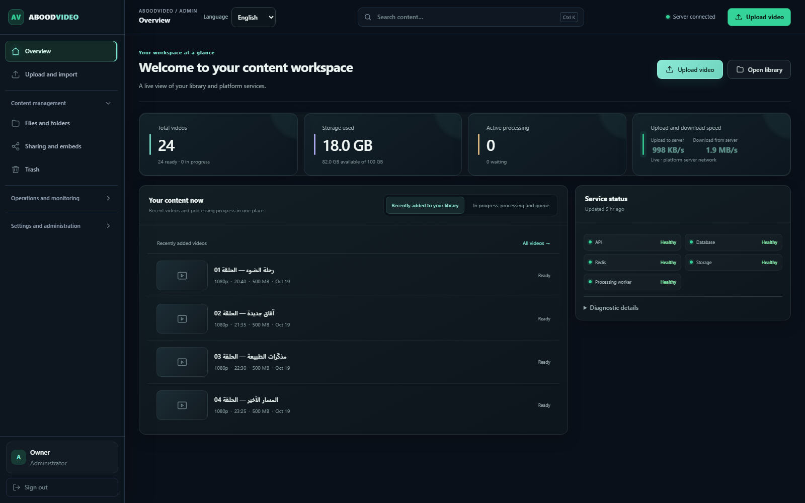
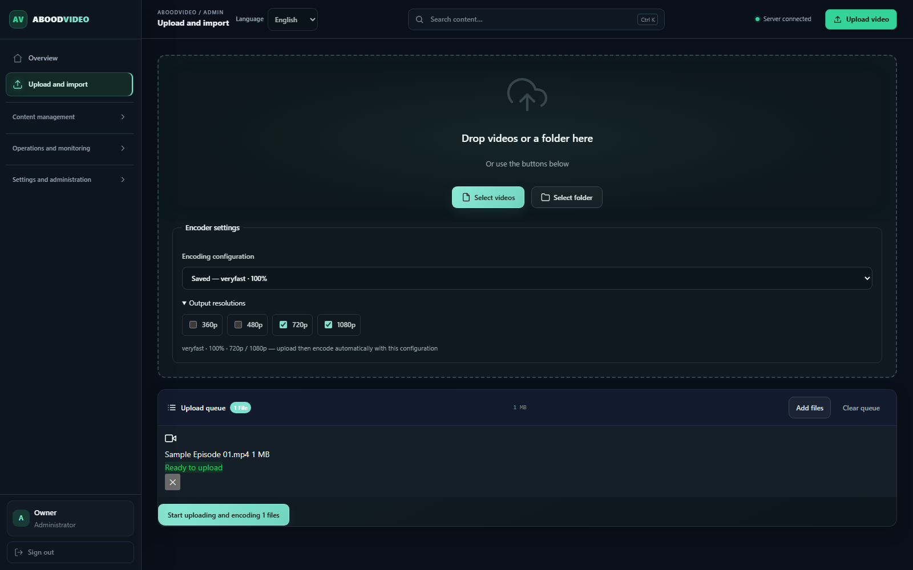
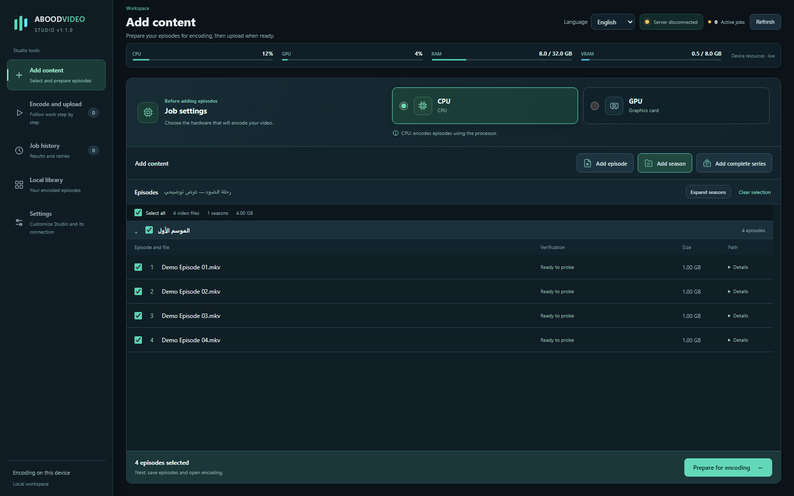
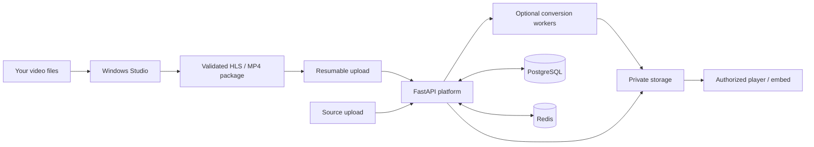

# ABOODVIDEO

**English** · [العربية](README.ar.md)

<p align="center"></p>

<p align="center">
  <a href="https://github.com/abooodHub/ABOODVIDEO/releases"></a>
  <a href="https://github.com/abooodHub/ABOODVIDEO/actions/workflows/checks.yml"></a>
  <a href="LICENSE"></a>
  
</p>

<p align="center"><strong>Styled subtitles without burning them into your video.</strong><br>ASS/SSA styling, positioning and attached fonts — rendered in the player, with subtitles you can switch or hide.</p>

<p align="center"><a href="#screenshots">Screenshots</a> · <a href="#quick-start">Install</a> · <a href="docs/INSTALLATION.md">Operations</a> · <a href="https://github.com/abooodHub/ABOODVIDEO/releases">Releases</a></p>

## The headline feature: soft subtitles, without burn-in

**Show styled subtitles over the video while keeping them separate from its image.** The player renders ASS/SSA styling, positioning and attached fonts, with WebVTT support as well. Viewers can switch subtitle tracks or turn them off.

- **Preserve the video image:** subtitles are displayed by the player, not burned into the frames.
- **Keep the intended look:** ASS/SSA styles, placement and attached fonts travel with the subtitle package.
- **Give viewers control:** switch tracks or hide subtitles during playback.
- **Prepare in Studio, play on the Platform:** package subtitle files and fonts on Windows, then upload them with the video.

## What is included?

| | Platform | Windows Studio |
| --- | --- | --- |
| **Soft subtitles — no burn-in** | ASS/SSA styles, positioning, attached fonts and WebVTT; switch or hide tracks | Package subtitle files and fonts alongside the video |
| Organization | Files, folders, series and seasons | Discover episodes and review the queue |
| Video preparation | Server conversion or prepared HLS/MP4 imports | CPU/GPU encoder and conversion controls |
| Uploads | Resumable transfers and package validation | Persistent queue with explicit start controls |
| Playback | Authorized HLS, MP4 and embeds | Prepare and upload to your own server |
| Administration | Accounts, roles, storage and analytics | Connection settings and Windows DPAPI credentials |
| Languages | Arabic RTL and English LTR | Arabic RTL and English LTR |

No public homepage or catalog. `/`, `/browse` and `/watch/` return empty HTTP 404 responses. Valid `/watch/<id>` and embed links retain their authorization, including PRIVATE protection. No deployment address or external partner is preconfigured.

## Arabic and English

Choose **العربية** or **English** in the language selector. Arabic keeps the sidebar on the right; English places it on the left. The preference persists between visits. Studio also saves it in its local settings. Menus, forms, status messages and player controls follow the selected language. Video titles, filenames, subtitle content and saved media are preserved.

The Windows installer supports English and Arabic. Native operating-system dialog chrome follows Windows; the application's picker captions and filters follow the selected application language.

<p align="center"></p>

## Screenshots

Actual interfaces rendered with offline synthetic data. Counts, titles and hardware values are examples, with no production accounts or deployment addresses.

### English — sidebar on the left



<details>
<summary>Upload and encoder controls</summary>



</details>



<details>
<summary>Arabic — sidebar on the right</summary>


</details>

## Quick start

### Platform — local installation

Install Docker with Compose **2.24.4+** and Python **3.12**, then:

```sh
git clone https://github.com/abooodHub/ABOODVIDEO.git
cd ABOODVIDEO
python3 scripts/install_platform.py --ready-only --start
```

For a new local installation accepting prepared HLS/MP4. The installer creates private secrets and prompts for an owner account. Open `/admin` at the address it prints. Omit `--ready-only` to enable server conversion workers. For internet hosting, configure your own hostname and automatic HTTPS as described in [Installation](docs/INSTALLATION.md). Existing configuration is never overwritten.

### Studio — Windows

Download the portable ZIP or setup package from [Releases](https://github.com/abooodHub/ABOODVIDEO/releases). Configure **your own server URL** and Studio API key in Settings. A new installation has no server address saved.

To run from source:

```powershell
py -3.12 -m venv .venv
.venv\Scripts\python.exe -m pip install -r requirements-studio.txt
.venv\Scripts\python.exe -m studio.main
```

Install FFmpeg/FFprobe and Microsoft WebView2 Runtime for source execution. See [development and builds](docs/DEVELOPMENT.md) and [third-party notices](THIRD_PARTY_NOTICES.md).

## Architecture



## Documentation

| Guide | Contents |
| --- | --- |
| [Installation](docs/INSTALLATION.md) | New server, HTTPS, owner account, upgrades and Windows prerequisites |
| [Deployment modes](docs/DEPLOYMENT_MODES.md) | Server conversion versus prepared-media imports |
| [Languages and translation](docs/LOCALIZATION.md) | Arabic/English preferences, layout and translation contributions |
| [Development](docs/DEVELOPMENT.md) | Dependencies, isolated tests and reproducible builds |
| [Project map](PROJECT_MAP.md) | Platform, Studio and deployment source layout |
| [Architecture](docs/ARCHITECTURE.md) · [API](docs/API.md) | Services, storage and API contracts |
| [Changelog](CHANGELOG.md) · [Current state](docs/CURRENT_STATE.md) | Release scope and validation limits |
| [Security](SECURITY.md) · [Contributing](CONTRIBUTING.md) | Reporting issues and contributing changes |

## Release status

Platform and Studio source are version **1.1.0**. Automated source/browser tests and actual portable Windows launches have been exercised. The project executable and installer are **unsigned**. A clean Windows installer / upgrade / uninstall cycle, including a machine without WebView2, remains unverified. See release notes for the exact checks attached to each artifact.

Runtime databases, media, private settings, local backups and development history are excluded from this repository. The screenshot generator uses offline fixtures only; [regenerate the gallery](scripts/generate_documentation_visuals.py) without accessing a deployment.

## License

[MIT](LICENSE) © 2026 abood. Bundled third-party components retain their own licenses; see [THIRD_PARTY_NOTICES.md](THIRD_PARTY_NOTICES.md).
